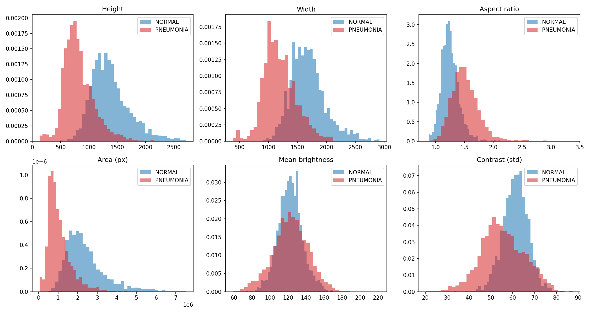
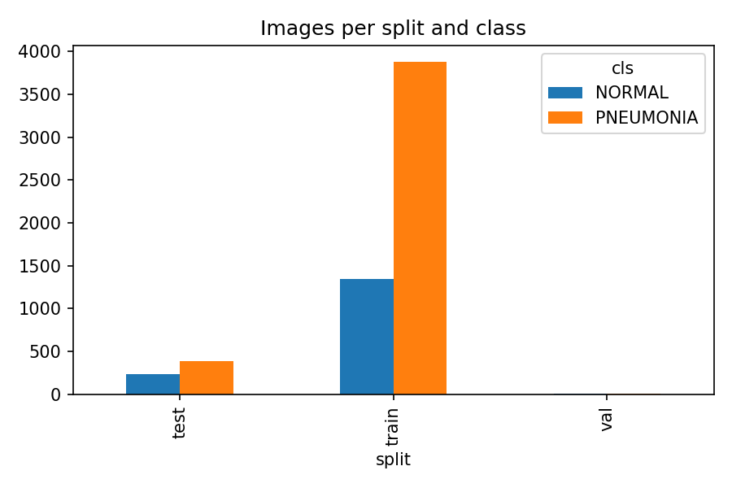
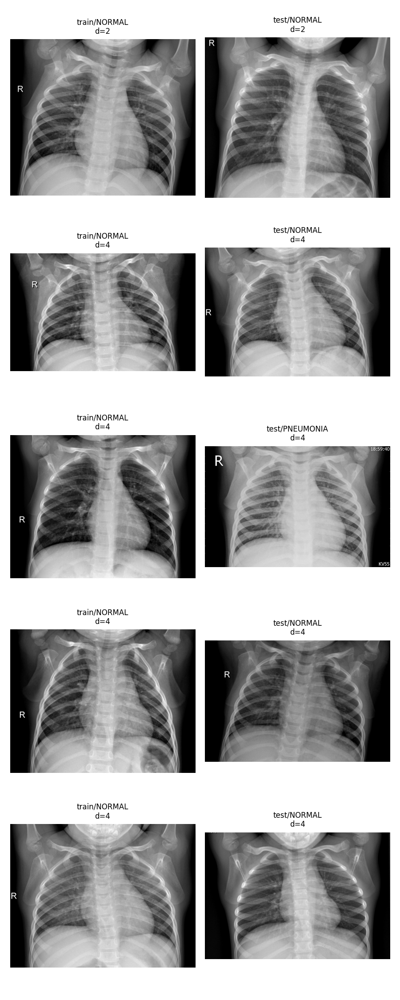

# Part 1: Audit of the MediScan data

All numbers below come from scripts in this repo (script and output file named in each section).

## 1. Inventory and pixel statistics
*Script: `audit.py`. Outputs: `outputs/inventory.csv`, `counts.csv`, `pixel_stats_by_class.csv`; figures `fig01`, `fig02`.*

**Counts.** The primary dataset holds 5,856 images (train 5,216, test 624, val 16). Class balance is 1,583 NORMAL and 4,273 PNEUMONIA (73.0% pneumonia); the test set is 62.5% pneumonia, so the splits are not even drawn from the same class ratio.

**Greyscale.** All 5,856 images are truly greyscale: 5,573 are stored as single-channel and 283 are stored as RGB with identical channels.

**Size and shape.** [Insert fig01.] PNEUMONIA images are smaller and wider than NORMAL ones: mean area 1.05M vs 2.42M pixels (2.3x), mean height 820 vs 1,379, mean aspect ratio 1.51 vs 1.25.

**Brightness and contrast.** Mean brightness is the same (122.8 vs 122.6). PNEUMONIA images vary more in brightness across images (SD 19.9 vs 13.5) and have slightly lower contrast (55.4 vs 61.3).

**What this implies.** The two classes differ in acquisition geometry (image size and aspect), which has nothing to do with lungs. A network can therefore reach a good score by learning "small and wide means pneumonia". Such a model would fail at a camp whose equipment produces different image sizes. Tasks 4 and 8 test this directly.

  
   
  <em>Figure 1: Pixel stats by class.</em>

  
   
  <em>Figure 2: Counts.</em>

## 2. Duplicates and leakage
*Scripts: `audit.py`, `leakage_check.py`. Outputs: `outputs/exact_duplicates.csv`,
`near_duplicate_pairs.csv`, `leakage_check.csv`; figure `fig03`.*

**Method.** Perceptual hash (pHash, 64 bits) on greyscale images; pairs with Hamming distance
<= 5 are near-duplicates. Patient identity was parsed from filenames. A first parse (person
number only) merged different children, because `personN_bacteria_*` and `personN_virus_*`
are numbered separately, and the NORMAL series `IM-XXXX` (train) and `NORMAL2-IM-XXXX` (test)
reuse the same numbers. It reported 264 shared IDs, which inspection showed to be false. The
strict ID used for the leakage check keeps the bacteria/virus tag and the NORMAL2 prefix.

**Results.**
| Check | Count |
|---|---|
| Files in exact-duplicate sets (identical bytes) | 62 in 30 sets (32 redundant copies) |
| ...sets spanning more than one split | 0 |
| Near-duplicate pairs (distance <= 5), all | 265 |
| ...within the same split | 238 |
| ...between train and test | 26 (1 at distance 2, 25 at distance 4) |
| ...between val and another split | 1 |
| Near-duplicate pairs with conflicting labels | 40 (all at distance 4; none at distance <= 2) |
| Pair distances (all 265) | 0: 34, 2: 16, 4: 215 |
| Strict patient IDs present in both train and test | 0 (0 of 624 test images) |

  
   
  <em>Figure 3: The five closest train/test pairs.</em>

**Interpretation.** We found no evidence that the previous engineer's test set leaked from the
training set: no exact duplicate and no strict patient ID crosses train and test, and only 26
of 265 near-duplicate pairs do, almost all at distance 4, where look-alike chest X-rays are
common. All 40 label-conflicting pairs are at distance 4 [and the closest four are visibly
different X-rays], so we treat them as hash false positives rather than label noise. Patient
identity is inferred from filenames only, so hidden overlap cannot be excluded. The 98.4% is
therefore not explained by simple leakage, and the remaining explanations (a class mix in
the test set that differs from training, a single hospital and age group, and the size and shape
differences between the classes in Section 1) are examined in Sections 4 and 8.

## 3. The validation set
*Script: `split.py`. Outputs: `outputs/val16_ci.csv`, `split.csv`, `split_summary.csv`, `split.md5`.*

**Why 16 images is useless.** A model scoring 16/16 has an observed accuracy of 100%, but the
95% Clopper-Pearson interval is [0.794, 1.000]. The true accuracy could be as low as 79%, so a
validation set of this size cannot detect overfitting or tell two models apart.

**Replacement design.** The three original folders were pooled (5,856 images). The 32 exact
duplicate files were removed, leaving 5,824 images. Images were then grouped so that no group
crosses a split: images with the same patient ID, and images whose perceptual hashes differ by
at most 2 bits and share a label, are placed in the same group (2,773 groups). A stratified
grouped split then produced a locked test set (about 15%, not touched until the final
evaluation), a validation set (about 15%) and a training set (about 70%). A 5-fold stratified
grouped assignment on the non-test pool (train + val) is also stored for Part 2. The script
asserts that no group or patient appears in more than one of train, val and test.

**A grouping problem we found and fixed.** A first attempt linked images with a hash distance
of up to 5 (the audit threshold). This chained 188 images from 105 different patients (154
NORMAL, 34 PNEUMONIA) into a single group, because chest X-rays resemble each other and
similarity links form chains (A~B, B~C...). A group cannot be split, so this made the class
balance uneven (test set 0.81 pneumonia). We tightened the grouping threshold to 2 bits and
linked only images with the same label. The largest group is now 31 images and the class
balance is even across train, validation and test. No model performance was used in any of
these choices.Patient IDs used for grouping were parsed from filenames without the bacteria/virus tag or the NORMAL2 prefix, so some different children share an ID. This makes groups larger than necessary, which can only reduce leakage across splits.

| Split | NORMAL | PNEUMONIA | Total | Pneumonia fraction |
|---|---|---|---|---|
| Train | 1,114 | 3,006 | 4,120 | 0.730 |
| Validation | 227 | 625 | 852 | 0.734 |
| Test (locked) | 238 | 614 | 852 | 0.721 |

Split table: `outputs/split_summary.csv`. Frozen split file hash (MD5):
`d7a8298d0b456ed277a60be0d6ca3934`. Split seed: 42 (test), 43 (validation), 44 (CV folds),
set in `split.py`.

| Fold (train + val pool) | 0 | 1 | 2 | 3 | 4 |
|---|---|---|---|---|---|
| NORMAL | 253 | 260 | 288 | 275 | 265 |
| PNEUMONIA | 768 | 717 | 675 | 739 | 732 |

**Why a locked test plus cross-validation, and not either alone.**
- *k-fold alone* leaves no untouched final estimate, because every image is used in some
  fold while choices (thresholds, hyperparameters) are being made. It is also five times as
  expensive for deep networks.
- *A single split alone* gives one validation score with no estimate of its own spread, so
  it cannot say whether a difference between two models is real.
- The locked test set gives one honest final number; the 5 folds give a mean ± SD for
  Part 2 and show how stable the result is.

  **Preprocessing and caching.** *Script: `cache_data.py`. Output: `outputs/cache/` (`X96.npy`,
`X224.npy`, `y.npy`, `meta.csv`).* All 5,824 pooled images were converted to greyscale and
resized to 96×96 and 224×224 pixels (JPEG decoded at reduced size with PIL, then bilinear
resize; aspect ratio is not preserved) and stored as uint8 arrays in the row order of
`split.csv`. The original height, width, aspect ratio, area and mean intensity are kept in
`meta.csv`, because resizing to a square removes the size and shape differences found in
Section 1; the two-branch model (task 8) and the shortcut test (task 4) use them. All
experiments read these arrays, fit on the train split and are evaluated on the validation
split; the test split is not used until the final evaluation.

## 4. Shortcut hunt: [TODO after shortcut.py]
## 5. Baselines: [TODO after baselines.py]
## 6. Transfer baseline: [TODO; prediction goes in reports/predictions.md BEFORE results]
## 7. ArogyaNet: [TODO; hypotheses go in reports/hypotheses.md BEFORE ablations]
## 8. Two-branch experiment: [TODO]
## 9. Resolution and augmentation ablations: [TODO]
