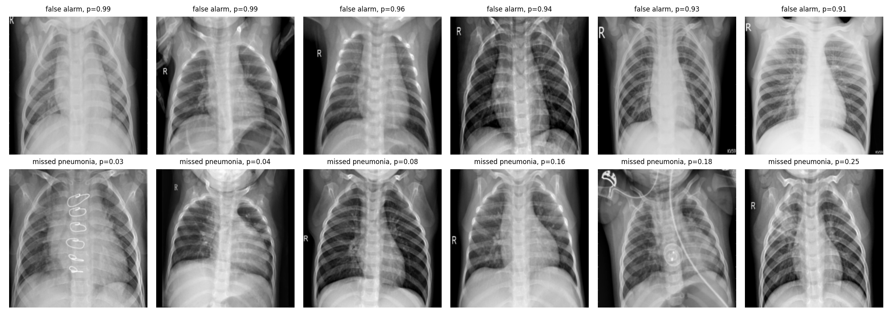
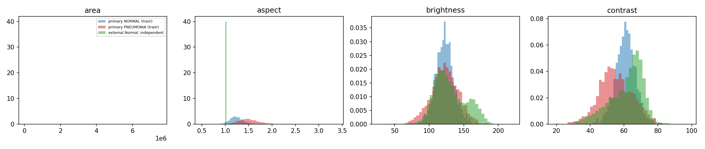

## Task 1: Operating point at camp prevalence
*Script: `threshold.py`. Outputs: `outputs/threshold_sensitivity.csv`, `chosen_threshold_val_runs.csv`,
`camp_arithmetic.csv`, `operating_point.json`; figure `fig06_roc_pr_cost_chosen.png`.*

**Method.** Expected cost per 1,000 children at the camp (10% sick, 100 sick and 900 healthy) is
20 × missed pneumonia + 1 × false alarm. Recall and specificity do not depend on prevalence, so the
validation rates of the standard ArogyaNet (3 seeds pooled) were converted to camp costs without
retraining. The chosen threshold is the middle of the thresholds whose cost is within 2% of the
minimum.

| Threshold | Recall | Specificity | Cost per 1,000 |
|---|---|---|---|
| 0.5 (default) | 0.980 | 0.928 | 104.2 |
| 0.048 (cost ratio only, ignores prevalence) | 0.996 | 0.799 | 189.6 |
| 0.548 (theory, assumes calibrated probabilities) | 0.976 | 0.933 | 108.8 |
| **0.416 (chosen)** | **0.984** | **0.925** | **99.4** |

**Findings.** At the chosen threshold, validation recall is 0.984 ± 0.002 and specificity
0.925 ± 0.004 (3 seeds). At camp prevalence about 59% of flagged children are truly sick (PPV
0.594 ± 0.015): per 1,000 children, 98 sick children are found, 1.6 are missed and 67 healthy
children are flagged. The cost curve is flat between about 0.3 and 0.55 (99 to 109 per 1,000, seed
SD 7), so the choice of 0.416 over 0.5 is not statistically distinguishable. A threshold derived from the
cost ratio alone (1/21) ignores the prevalence shift and nearly doubles the cost, because specificity
falls to 0.80. The best threshold also depends strongly on the assumptions (0.17 to 0.89 for
prevalence 5 to 20% and cost ratio 10 to 40), so the cost ratio and prevalence need clinical
confirmation. Moving the threshold on one trained model changes recall (1.00 to 0.81) and specificity
(0.66 to 0.99) but not ROC-AUC (0.9928 throughout), so it changes the decision, not the model.
[Class-weight comparison: add after the rerun.]

**Why accuracy is the wrong headline.** Per 1,000 camp children, a tool that refers nobody scores
90% accuracy and misses all 100 sick children (cost 2,000). Two hypothetical models with the same 99%
accuracy cost 200 (all errors are misses) and 10 (all are false alarms), a 20-fold difference.
ArogyaNet has lower accuracy at the camp (93.1%) but a lower cost (99) than the first hypothetical
model. Accuracy also changes with prevalence: 96.8% on the validation split (73% sick) and 93.1% at
10% sick.

[Class-weight comparison: add after the rerun.]

**Class weights versus threshold moving.** A positive-class weight of 0.371 (equal total weight for the
two classes) changes the trained network: its scores and per-seed results differ from the standard
model (validation ROC-AUC 0.9925 ± 0.0009 vs 0.9919 ± 0.0009; recall at 0.5 0.979 vs 0.980;
specificity at 0.5 0.922 ± 0.018 vs 0.928 ± 0.005). The effect is small and within the seed
spread, and the weighted model is less stable (specificity SD 3.6 times larger). Placing the weighted
model's operating point against the standard model's ROC curve shows no consistent gain
(specificity at equal recall differs by +0.022, −0.009, −0.018 across seeds), so class weighting moved the operating
point rather than improving the ranking. A plausible reason is that the classes are nearly separable
(AUC 0.99), so reweighting affects only images near the boundary. Moving the threshold on one trained
model changes recall (1.00 to 0.81) and specificity (0.66 to 0.99) but not ROC-AUC (0.9928 throughout):
it changes only the decision. The training-side treatment needs a retraining for each setting and
gives one operating point, while threshold moving costs nothing and can be reset for any prevalence.
We therefore use the standard loss and a moved threshold.

**Caveats.** The threshold was chosen on the validation split, which was also used for early
stopping, so the cost is optimistic; the locked test set is used once, in task 2, with this
threshold frozen. Validation holds only 227 healthy images.

## Task 3: Hyperparameter tuning and regularisation
*Script: `tune.py`. Outputs: `outputs/tune_search.csv`, `tune_curves.csv`,
`tune_overfitting_summary.csv`, `tune_final_default_runs.csv`, `tune_final_tuned_runs.csv`;
figure `fig07_overfitting_curves.png`.*

**Search and budget.** Random search, 20 trials, over learning rate (3e-4 to 5e-3, log scale), batch
size (32, 64, 128), dropout (0 to 0.5) and weight decay (1e-6 to 1e-2, log scale). Each trial trained
ArogyaNet at 96×96 with seed 0 and augmentation, up to 20 epochs with early stopping on validation loss
(patience 6), and was ranked by validation ROC-AUC; the search took about 9 minutes on a T4. The best
trial (lr 0.0033, batch size 64, dropout 0.37, weight decay 2.7e-5, ROC-AUC 0.9932 at 96 px) was
retrained at 224×224 over three seeds and compared with the default (lr 2e-3, batch size 64, dropout 0.2,
weight decay 1e-4). Decision rule fixed beforehand: adopt the tuned configuration only if its mean
validation ROC-AUC exceeds the default's by more than 0.002.

| 224×224, 3 seeds, validation | Default | Tuned |
|---|---|---|
| ROC-AUC | 0.9919 ± 0.0009 | 0.9929 ± 0.0005 |
| PR-AUC | 0.9969 ± 0.0004 | 0.9973 ± 0.0002 |
| Balanced accuracy | 0.9542 ± 0.0042 | 0.9544 ± 0.0040 |
| Specificity | 0.9280 ± 0.0051 | 0.9280 ± 0.0092 |
| Recall | 0.9803 ± 0.0051 | 0.9808 ± 0.0016 |

**Decision.** The gain in ROC-AUC (+0.0010) is below the margin, so the default configuration is kept.
The search spread (0.983 to 0.993) is about three times the single-seed noise at 96 px (SD about
0.003), so the ranking of the best trials is not reliable and the best trial's score is probably
inflated by selection on the validation split. One pattern is clear: all eight trials with learning rate
≥ 1.5e-3 reached ROC-AUC ≥ 0.989, and the two worst had lr ≈ 3e-4 to 4e-4 (under-training within the
20-epoch budget); the default lr of 2e-3 lies in the good region. Dropout, weight decay and batch size
showed no visible effect. Limits: one seed per trial, search at 96 px with transfer to 224 px assumed,
and the validation split used for both the search and the early stopping.

**Overfitting curves (seed 0, 30 epochs, no early stopping; figure `fig07`).**

| Run | Epoch of lowest val loss | Val loss at best | Val loss at epoch 30 | Train loss at best → at 30 | Epochs saved by early stopping |
|---|---|---|---|---|---|
| Unregularised (no dropout, no weight decay, no augmentation) | 4 | 0.171 | 0.240 | 0.078 → 0.0005 | 26 |
| Regularised, default | 19 | 0.094 | 0.104 | 0.080 → 0.059 | 11 |
| Regularised, tuned | 26 | 0.096 | 0.102 | 0.049 → 0.044 | 4 |

Without regularisation the network overfits from epoch 4: training loss falls to 0.0005 while
validation loss rises 40% above its minimum; early stopping saves 26 of 30 epochs and 0.069 of
validation loss. With dropout, weight decay and augmentation the validation minimum moves to epoch 19
and the penalty for training on to epoch 30 is small (+0.010), so early stopping mainly saves compute.
One seed; validation loss fluctuates between epochs (Section 6), so the best epochs are approximate.

## Task 2: Evaluation
*Scripts: `cv_eval.py` (cross-validation); the locked-test evaluation is added after the final
freeze. Outputs: `outputs/cv_folds.csv`, `cv_summary_thr0.4158.csv`, `cv_summary_thr0.5000.csv`,
`cv_oof_preds.csv`.*

**5-fold stratified, grouped cross-validation on the training pool** (train + validation, 4,972
images; folds from `split.csv`, grouped by patient and near-duplicate cluster). Each fold trains
ArogyaNet (default configuration) from scratch on the other four folds for 30 epochs and is scored
with its final-epoch weights, so nothing is selected on the held-out fold.

| Metric (mean ± SD over 5 folds) | Threshold 0.416 (chosen) | Threshold 0.5 |
|---|---|---|
| Accuracy | 0.9655 ± 0.0038 | 0.9660 ± 0.0037 |
| Balanced accuracy | 0.9545 ± 0.0078 | 0.9575 ± 0.0058 |
| Precision | 0.9748 ± 0.0071 | 0.9777 ± 0.0059 |
| Recall (sensitivity) | 0.9780 ± 0.0084 | 0.9755 ± 0.0084 |
| Specificity | 0.9311 ± 0.0219 | 0.9394 ± 0.0176 |
| F1 | 0.9764 ± 0.0032 | 0.9766 ± 0.0032 |
| ROC-AUC | 0.9934 ± 0.0021 | 0.9934 ± 0.0021 |
| PR-AUC | 0.9975 ± 0.0009 | 0.9975 ± 0.0009 |
| Camp precision (10% sick) | 0.619 ± 0.071 | 0.647 ± 0.064 |
| Camp cost per 1,000 children | 106.0 ± 10.9 | 103.4 ± 9.5 |

Pooled over all out-of-fold images, threshold 0.416: TN 1,249, FP 92, FN 79, TP 3,552 (threshold
0.5: TN 1,260, FP 81, FN 88, TP 3,543).

**Reading.** Cross-validation agrees with the single validation split (balanced accuracy 0.955 vs
0.954, ROC-AUC 0.993 vs 0.992). Specificity ranges from 0.898 to 0.955 across folds, so one
validation split with 227 healthy images is more uncertain than its seed spread suggests. Expected
camp cost is 106 ± 11 per 1,000 children, slightly above the validation estimate (99). The chosen
threshold is not distinguishable from 0.5 (cost 106.0 vs 103.4), as expected from the flat cost
curve in Task 1; we keep it because it was fixed before cross-validation. Because the threshold was
selected on the validation split, which is part of the pool, the figures at 0.416 are slightly
optimistic.

**Why accuracy alone is the wrong headline.** At the camp's 10% prevalence a tool that refers
nobody is 90% accurate while missing every sick child, so accuracy rewards ignoring the class we
care about. A miss costs about 20 false alarms, so two models with the same accuracy can differ
twenty-fold in expected cost; we therefore report recall, specificity and expected cost at a stated
threshold.

**Locked test set:** [added after the final freeze].

**Locked test set, evaluated once.** *Script: `final_eval.py`. Outputs: `outputs/test_runs.csv`,
`test_preds_seed0.csv`; figure `fig10_test_confusion.png`.* The system was fixed beforehand: ArogyaNet
(default configuration, seed 0), threshold 0.416. The test split has 852 images (238 NORMAL, 614
PNEUMONIA). Confusion matrix: TN 216, FP 22, FN 10, TP 604.

| Metric | Value | 95% CI (bootstrap, 1,000 resamples) |
|---|---|---|
| Accuracy | 0.9624 | [0.9495, 0.9754] |
| Balanced accuracy | 0.9456 | [0.9273, 0.9642] |
| Precision | 0.9649 | [0.9508, 0.9791] |
| Recall (sensitivity) | 0.9837 | [0.9731, 0.9934]; exact [0.9703, 0.9922] |
| Specificity | 0.9076 | [0.8708, 0.9431]; exact [0.8634, 0.9412] |
| F1 | 0.9742 | [0.9645, 0.9830] |
| ROC-AUC | 0.9937 | [0.9899, 0.9968] |
| PR-AUC | 0.9976 | [0.9961, 0.9988] |
| Camp precision (10% sick) | 0.542 | [0.458, 0.658] |
| Camp cost per 1,000 children | 115.8 | [77.1, 153.9] |

Seeds 1 and 2 (robustness only; the headline seed was fixed in advance): balanced accuracy 0.9515 and
0.9453, recall 0.987 and 0.979, specificity 0.916 and 0.912; mean ± SD over three seeds: balanced
accuracy 0.9475 ± 0.0035, recall 0.983 ± 0.004, specificity 0.912 ± 0.004, camp cost 113 ± 10.

**Agreement with validation and cross-validation.** Recall (0.984), ROC-AUC (0.994) and balanced accuracy
(0.946 against 0.955) agree. Specificity is lower on the test split (0.908 against 0.925 on validation and
0.931 in cross-validation), but its 95% interval (0.863 to 0.941) contains both, so we do not call this a
drop; validation was also used for early stopping and for choosing the threshold, which makes its figures
slightly optimistic. At the camp's 10% prevalence the expected result per 1,000 children is about 98 sick
children found, 1.6 missed and 83 healthy children flagged; only 54% of flagged children are truly sick.
The frozen threshold (0.416) did not outperform 0.5 on the test split (about 18 false alarms and 12
misses at 0.5, against 22 and 10), a difference well within the noise, and it was not changed. This
test split is a new grouped split of the pooled images and is not comparable with the previous
engineer's 98.4%, which was measured on the original test folder.

*Run history:* `final_eval.py` was run twice; the first run stopped at a formatting error in a print
statement after the metrics were computed, and the fix changed no model, threshold or metric code.

## Task 4: Ensembles
*Scripts: `ensemble.py`, `features.py`. Outputs: `outputs/ensemble_table.csv`, `embed_models_runs.csv`.*

**Method.** Soft voting averages the predicted probabilities of the members. Members are the Part 1
models (ArogyaNet full, without residual connections, without SE, two-branch, and fine-tuned ResNet18),
combined seed by seed (seed s of every model), so each ensemble row is a mean ± SD over three seeds. Random
Forest (300 trees) and AdaBoost (200 stumps) were trained on the 256-dimensional penultimate-layer
embeddings of ArogyaNet (training split only). Everything is evaluated on the validation split at
threshold 0.5.

| Model / Variant | Balanced Acc. | Specificity | Recall | ROC-AUC | PR-AUC |
| :--- | :---: | :---: | :---: | :---: | :---: |
| **ArogyaNet full** | 0.9542 ± 0.0042 | 0.9280 ± 0.0051 | 0.9803 ± 0.0051 | 0.9919 ± 0.0009 | 0.9969 ± 0.0004 |
| **ArogyaNet no residual** | 0.9544 ± 0.0073 | 0.9280 ± 0.0067 | 0.9808 ± 0.0085 | 0.9920 ± 0.0006 | 0.9969 ± 0.0003 |
| **ArogyaNet no SE** | 0.9479 ± 0.0048 | 0.9192 ± 0.0092 | 0.9765 ± 0.0024 | 0.9914 ± 0.0010 | 0.9967 ± 0.0004 |
| **ArogyaNet two-branch** | 0.9532 ± 0.0070 | 0.9266 ± 0.0102 | 0.9797 ± 0.0040 | 0.9926 ± 0.0006 | 0.9973 ± 0.0002 |
| **ResNet18 (ImageNet)** | 0.9630 ± 0.0028 | 0.9398 ± 0.0111 | 0.9861 ± 0.0067 | 0.9958 ± 0.0006 | 0.9984 ± 0.0003 |
| **Random Forest on embeddings** | 0.9530 ± 0.0035 | 0.9236 ± 0.0051 | 0.9824 ± 0.0028 | 0.9840 ± 0.0026 | 0.9903 ± 0.0018 |
| **AdaBoost on embeddings** | 0.9465 ± 0.0036 | 0.9148 ± 0.0025 | 0.9781 ± 0.0046 | 0.9854 ± 0.0030 | 0.9919 ± 0.0037 |
| **Soft vote, 4 ArogyaNet variants** | 0.9574 ± 0.0027 | 0.9339 ± 0.0044 | 0.9808 ± 0.0016 | 0.9934 ± 0.0006 | 0.9975 ± 0.0003 |
| **Soft vote, 4 ArogyaNet + ResNet18** | 0.9602 ± 0.0034 | 0.9354 ± 0.0067 | 0.9851 ± 0.0024 | 0.9949 ± 0.0009 | 0.9981 ± 0.0003 |
| **Soft vote, 3 seeds of ArogyaNet (1 run)** | 0.9544 | 0.9295 | 0.9792 | 0.9932 | 0.9975 |
| **Soft vote, 3 seeds of ResNet18 (1 run)** | 0.9664 | 0.9471 | 0.9856 | 0.9967 | 0.9987 |

> **Note:** Values represent Validation metrics at a threshold of 0.5, reported as mean ± SD over 3 seeds (unless specified as a single 1-run ensemble).

**Does the ensemble beat its best member?** The ArogyaNet-only vote improves on its best member by 0.003
balanced accuracy (0.9574 vs 0.9544) and 0.0008 ROC-AUC, within the seed spread. The vote that adds
ResNet18 does not beat ResNet18 alone (0.9602 vs 0.9630 balanced accuracy; ROC-AUC 0.9949 vs 0.9958).
Reasons: (1) the members are unequal, since ResNet18 made 20 errors on seed 0 against 31 to 34 for the
others, so an unweighted average pulls it toward weaker models; (2) the errors are largely shared: the mean
pairwise error overlap (Jaccard) is 0.56, probabilities correlate at 0.83, and 15 images are wrong in
every member, of 51 that are wrong in at least one, so voting can only change the 36 images on which the
members disagree, and the 15 shared errors (1.8% of the validation set) are a floor that no average can
remove. Averaging three seeds of the same model gains little for the same reason (ResNet18: +0.003 balanced
accuracy; ArogyaNet: +0.0002).

**Random Forest and AdaBoost on embeddings.** They do not beat the network's own classifier: balanced
accuracy 0.953 (Random Forest) and 0.947 (AdaBoost) against 0.954, and ROC-AUC 0.984 and 0.985 against
0.992. The embedding was trained jointly with the final linear layer, so the classes are already nearly
linearly separable and trees add nothing; their probabilities are also coarser, which costs ranking
resolution. [Trees were fitted on training embeddings, which are cleaner than validation embeddings
because the network has partly memorised the training set; this is a plausible explanation that we did
not test.]

**Decision.** We keep a single ArogyaNet (seed 0). A vote of three ArogyaNet seeds or four variants improves
validation ROC-AUC by 0.0013 to 0.0015, below the margin of 0.002 fixed in advance, and costs three to four
times the inference time. Limits: unweighted votes, validation split only, and "best member" is itself
chosen on the validation split.

## Task 5: Feature-space analysis
*Script: `features.py`. Outputs: `outputs/error_profile.csv`; figures `fig08_embeddings.png`,
`fig09_errors.png`.*

**Method.** The 256-dimensional penultimate-layer embedding (the pooled vector before the
classifier) of the seed-0 ArogyaNet was computed for the 852 validation images, reduced to two
dimensions with PCA and t-SNE (perplexity 30), and plotted by true class and by correct/incorrect at
the chosen threshold (0.416). k-means with k = 2 was run on the full 256-dimensional embeddings.
[Describe fig08: how the classes separate in PCA and t-SNE, and where the incorrect points lie.]

**k-means against the labels.**

| | NORMAL | PNEUMONIA |
|---|---|---|
| Cluster 0 | 11 | 602 |
| Cluster 1 | 216 | 23 |

Purity 0.960 (a clustering that ignores the data scores 0.734, the share of pneumonia images),
adjusted Rand index 0.840, NMI 0.726. Because the network was trained on these labels, this shows
that the last layer separates the classes, not that the classes cluster naturally in image space.
The 29 errors at threshold 0.416 (18 false alarms, 11 missed pneumonia) fall mostly in the smaller
cluster: 7.5% (18 of 239) against 1.8% (11 of 613), and that cluster also holds 23 sick children.

**What the misclassified images have in common.**
- *Image size.* 

  
   
  <em>Figure 9: error table.</em>
  
  False alarms have a median area of 1.36 M pixels against
  2.36 M for correctly classified healthy children; missed pneumonia cases have 1.65 M against
  0.97 M for correctly classified sick children. Each error type therefore has a size typical of the
  opposite class (Section 1 shows that NORMAL images are larger), consistent with the shortcut found
  in Section 4. This is suggestive only (18 and 11 images, medians, no significance test).
- *Confidence.* 67% of false alarms and 73% of missed pneumonia have a predicted probability
  between 0.1 and 0.9, against 9% and 6% of correct predictions, but the median false alarm has
  p = 0.86, so some errors are confident.

## Task 6: Generalisation test (external dataset, evaluated once)
*Script: `external_eval.py`; post-hoc diagnostic: `external_posthoc.py`. Outputs: `external_runs.csv`,
`external_preds.csv`, `external_pixel_stats.csv`, `external_posthoc.csv`; figures `fig11`, `fig12`.*

**What the external data really contain.** The external folder holds 11,537 images (10,192 Normal, 1,345
Viral Pneumonia). Near-duplicate screening against all 5,824 primary images (correlation of 32×32
thumbnails, cutoff 0.97; the count is the same from 0.97 to 0.99, and distinct primary images never exceed
0.974) flags **all 1,345 Viral and 1,341 Normal images, 2,686 in total**, as copies of primary images: 1,894
of our training split, 401 of the test split and 391 of the validation split. This agrees with the dataset's
documented sources (the Viral class and 1,341 Normal images come from the same Kaggle pediatric database as
our primary data; the other 8,851 Normal images come from the RSNA challenge). As distributed on
Kaggle, this dataset is therefore not independent of the primary data, and the independent remainder
(8,851 images) contains **no pneumonia cases**, so recall cannot be measured on independent external data.
The headline is the false-alarm rate on these images, which are adult radiographs from different sources
and equipment, whereas ArogyaNet was trained on children aged 1 to 5: this is a stress test of false
alarms, not a measurement of performance at the camp. The decision rules for this test were written before
the run: independent subset as headline; the fix is judged on the paired-bootstrap gain in balanced accuracy,
or in specificity when fewer than 30 positives exist.

**Results (frozen models and thresholds, seed 0 unless stated).**

| Set | n | Metric | Default (thr 0.416) | Fix (thr 0.550) |
|---|---|---|---|---|
| Independent external Normal | 8,851 | Specificity | 0.651 (exact 95% CI 0.641 to 0.661) | 0.678 |
| | | 3-seed mean | 0.646 | 0.691 |
| Duplicates of primary training images | 1,894 | Recall / specificity | 0.981 / 0.983 | 0.942 / 0.992 |
| Duplicates of primary val/test images | 792 | Recall / specificity | 0.970 / 0.964 | 0.938 / 0.977 |
| Internal locked test (reference) | 852 | Recall / specificity | 0.984 / 0.908 | not evaluated |

**How far performance falls.** Specificity falls from 0.908 on the internal test to 0.651 on independent
external normals: the false-alarm rate rises from 9.2% to 34.9%, about 3.8-fold. The duplicate images behave
like internal data (they are internal data); they differ in ROC-AUC (0.9988 for copies of training images,
0.9935 for copies of val/test images), a small memorisation effect.

**Why (distribution mismatch).** Median pixel statistics (224×224 arrays; area and aspect from the
original files): primary NORMAL (train) area 2.18 M pixels, aspect 1.23, brightness 122.3, contrast 61.0;
primary PNEUMONIA (train) 0.89 M, 1.49, 122.7, 54.4; external independent Normal 89,401 (299×299), 1.00,
126.4, 63.9; external duplicates of primary Normal 89,401, 1.00, 122.1, 61.0 

  
   
  <em>Figure 11: external_pixel_stats.</em>

(1) All external
images are square 299×299, so the size and shape differences that separate the classes in the primary data
(Sections 1 and 4) carry no information there. 
(2) Independent normals are about 4 grey levels brighter and 3
more contrasty than primary normals, 0.3 and 0.5 of a per-image standard deviation; modest. 
(3) A control:
the 1,341 external Normal duplicates passed through the same file pipeline and have the same brightness and
contrast as primary normals, and are classified well (specificity 0.96 to 0.98), so file format and
resolution handling do not explain the drop. The difference must lie in the image content: a different
patient population (the independent images come from the RSNA challenge, predominantly adult patients),
scanners, exposure, framing and projection, which these summary statistics do not capture. Together with the
shortcut analysis (Section 4) and the finding that errors have image sizes typical of the other class (Task
5), a model that partly relies on such cues is expected to degrade when they change.

**The fix (pre-declared): retraining with stronger brightness and contrast augmentation** (brightness ±0.30,
contrast ±0.40 instead of ±0.10), threshold re-chosen on validation by the cost rule (0.550). At the frozen
thresholds its specificity on independent normals is 0.678 against 0.651 (seed 0; gain +0.027, paired-bootstrap
95% interval [+0.019, +0.034]; 3-seed mean 0.691 against 0.646), so the pre-declared rule is met. A post-hoc
diagnostic, run on the saved predictions after seeing this result, compares the models at the same threshold:
at 0.416 the 3-seed mean specificities are 0.647 (fix) and 0.646 (default); at 0.550 they are 0.691 and 0.671.
For seed 0 the gain is −0.011 [−0.018, −0.003] at 0.416 and +0.001 [−0.007, +0.007] at 0.550. Raising the default
model's own threshold from 0.416 to 0.550 already lifts its specificity from 0.646 to 0.671, about half of the
mean gain of +0.045, and the remainder is not consistent across thresholds and seeds, so we cannot attribute a
benefit to the retraining. The fix also lowers recall on in-distribution viral images (3-seed mean 0.962 against
0.980 at 0.416; 0.948 against 0.971 at 0.550; these images are copies of primary data), at 20 false alarms per miss
this is not clearly a good trade, its internal validation cost is worse (119 against 99 per 1,000 children),
and the false-alarm rate remains 31% to 35%. We therefore do not adopt it: the shipped model is the default
ArogyaNet. Raising the threshold alone does not repair a population shift either.

**Limits.** No independent positives, so no external recall; the independent images are normals from other
sources (predominantly adult patients); one fix was tried; the same-threshold diagnostic was added after seeing
the main result and is labelled post-hoc; the duplicate screen uses thumbnail correlation (stable across cutoffs
0.97 to 0.99).

## Task 7: Shipping
*Scripts: `build_gate.py`, `predict.py`, `app.py`, `band_eval.py`, `ood_tests.py`, `latency.py`. Files: `model/arogyanet.pt`,
`model/gate_stats.npz`, `model/config.json`. Outputs: `outputs/ood_tests.md`, `outputs/latency.md`.*

**Model and interface.** The shipped model is ArogyaNet (default configuration, seed 0, chosen before testing; 300,641
parameters) with the threshold 0.4158 fixed in Task 1. `predict.py <image>` prints the class and the probability of
pneumonia; `app.py` wraps it in a Gradio page. Preprocessing is identical to training (maximum pixel difference to the
cached training arrays: 0 on six checked images; probabilities agree with the validation run to within 0.001).

**Low-confidence band.** Probability below 0.4158: "no pneumonia suspected"; 0.4158 to 0.90: "LOW CONFIDENCE: refer to a
clinician"; 0.90 and above: "PNEUMONIA SUSPECTED: refer". The lower edge is the referral threshold evaluated in Tasks 1
and 2, so the shipped rule is the tested rule. Errors concentrate in the uncertain zone: on validation, 69% of errors but
7% of correct predictions have a probability between 0.10 and 0.90, and 5.8% of validation images fall in the band. A
lower edge of 0.10 would cut missed cases from 1.76 to 0.48 per 1,000 children but raise false alarms from 71 to 147
(cost 156 against 107), so we did not adopt it. 73% of the missed pneumonia cases have probabilities below the
threshold and are reported as "no pneumonia suspected", so the tool never replaces a clinician's judgement for a
symptomatic child; the screen says so.

**Input checks.** (1) Colour images (channel difference above 6 grey levels) are refused; (2) images with a pixel
standard deviation below 10 are refused (the smallest training image has 20); (3) an embedding-distance gate refuses images
whose squared Mahalanobis distance (256-dimensional embedding, Ledoit-Wolf covariance from the training split) exceeds
455, the 99th percentile of the validation split (median 198 on training, 206 on validation images).

| Test | Result |
|---|---|
| Blank white, blank black, uniform grey | Refused (blank) |
| Noise (colour), photos of a cat, astronaut, coffee and a dog (colour) | Refused (colour) |
| Noise (grey), gradient (grey), greyscale astronaut, coffee, dog | Refused by the embedding gate (d² 563 to 2,146) |
| Greyscale cat photo | **Not refused**: low confidence, p = 0.79, d² = 387 |
| 300 real chest X-rays from the primary data (mixed splits) | 8 refused (2.7%; 95% interval 1.4% to 5.2%) |

The dog photo and the blank image are refused, and no non-X-ray input receives a confident pneumonia or normal result. One of
12 non-X-ray test images, a greyscale photo of a cat, passed the gate and was sent to clinician review; the cutoff was
not changed after seeing it. About 1 in 37 genuine X-rays is refused. The gate was not tested on adult radiographs (the
external data may be used only once); the restriction to children rests on the external false-alarm result (Task 6).

**Speed and size.** [Measured on: Kaggle notebook CPU, 2 logical CPUs; replace or add your laptop.] Time per image in a
running process, including reading the file, preprocessing, the network and the checks (200 runs after warm-up): median
21.9 ms, 95th percentile 23.8 ms, maximum 27.8 ms with one thread (limit 200 ms); more threads do not help. Model files:
1.27 MB network, 0.26 MB gate statistics, 1.54 MB in total (limit 25 MB). [Add the cold-start time of `python predict.py`
measured on your laptop.]
