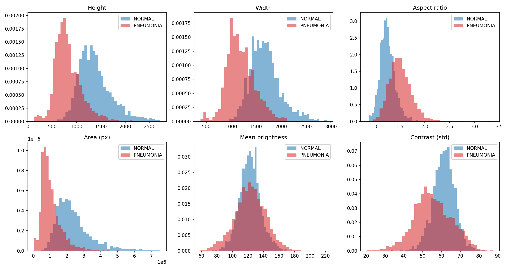
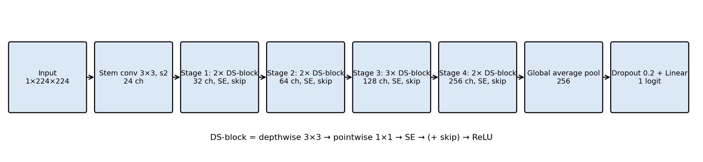
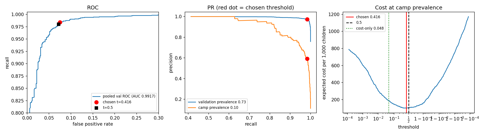
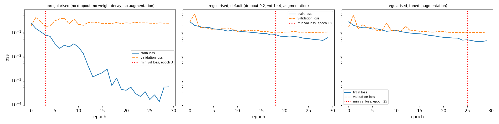
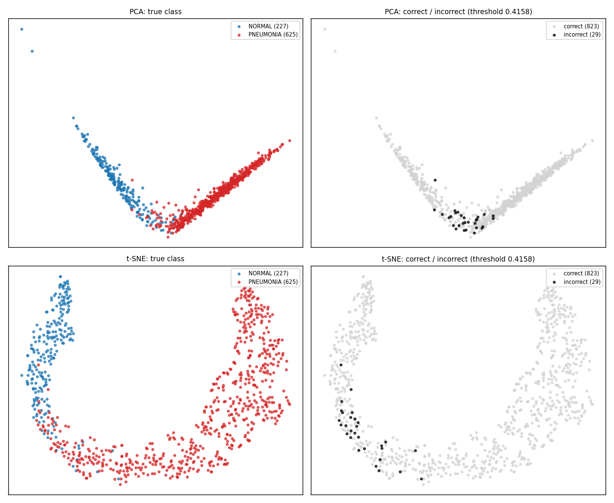
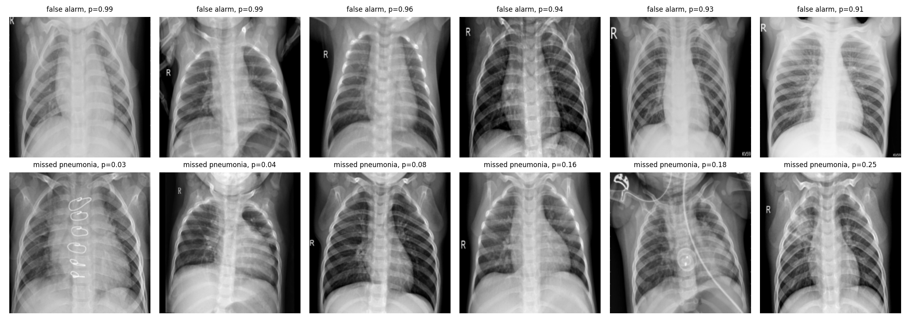

# MediScan Audit: technical report

Every table names its script and the CSV in `outputs/`; long versions are in `reports/Part1_audit.md` and `reports/Part2_results.md`. `run_all.sh` was rerun in a fresh session : headline numbers reproduced to four decimals, with two small exceptions listed in the README (split hash d7a8298d…3934).*

## 1. Summary
Arogya's pilot flagged 7 of 10 healthy children. The CEO asked for (1) proof of what the previous model did wrong, (2) a rebuild at 99% accuracy, (3) under 200 ms and 25 MB. We delivered (1) and (3) and show that (2) is the wrong target.

1. **What went wrong.** The previous 98.4% cannot support a deployment claim: its validation set had 16 images (a perfect score there is consistent with a true accuracy of 79%), its test set came from one hospital and was 62.5% pneumonia, and nothing was recorded. We found no evidence of leakage between his train and test folders, so 98.4% is plausibly an in-hospital figure, and the data contain shortcuts (three image-level numbers, size, shape and brightness, give ROC-AUC 0.905) that make in-hospital accuracy a poor guide to other equipment.
2. **99% accuracy is the wrong target.** At the camp's 10% prevalence, referring nobody scores 90%, and two 99%-accurate models can differ twentyfold in harm. We fix the operating point by expected cost (a miss costs 20 false alarms) and report sensitivity and specificity with intervals.
3. **Speed and size.** The shipped model (ArogyaNet, 300,641 parameters) takes a median of 18.5 to 22.9 ms per image on 2-CPU servers (limit 200 ms; not measured on a laptop) and its files total 1.5 MB (limit 25 MB).

*Table 1 (`threshold.py`, `cv_eval.py`, `final_eval.py`, `external_eval.py`). Threshold 0.416 fixed on validation.*

| Setting | Recall | Specificity | Balanced acc. | ROC-AUC | Camp cost / 1,000 |
|---|---|---|---|---|---|
| Validation (3 seeds pooled) | 0.984 | 0.925 | 0.955 | 0.992 | 99 ± 7 |
| 5-fold CV (mean ± SD) | 0.978 ± 0.008 | 0.931 ± 0.022 | 0.955 ± 0.008 | 0.993 ± 0.002 | 106 ± 11 |
| **Locked test, 852 images, once** | **0.984** [0.970, 0.992] | **0.908** [0.863, 0.941] | 0.946 | 0.994 | 116 [77, 154] |
| External independent normals (8,851; no positives) | n/a | 0.651 [0.641, 0.661] | n/a | n/a | n/a |

## 2. Data audit (Part 1, tasks 1 to 3; `audit.py`, `leakage_check.py`, `split.py`)
The primary data hold 5,856 greyscale chest X-rays (1,583 NORMAL, 4,273 PNEUMONIA; 74.3% pneumonia in the original training folder, 62.5% in the test folder). The classes differ in acquisition geometry: PNEUMONIA images are 2.3× smaller (1.05 M vs 2.42 M pixels) and wider (aspect 1.51 vs 1.25), with equal mean brightness (122.8 vs 122.6) and slightly lower contrast (55 vs 61), so a network can score well without looking at lungs.

  
   
  <em>Figure 1: size, aspect, brightness and contrast by class (`audit.py`).</em>

**Leakage.** Perceptual hashing found 62 files in 30 exact-duplicate sets (none across splits) and 265 near-duplicate pairs (distance ≤ 5): 238 within a split, 26 between train and test (25 at distance 4, 1 at distance 2) and 1 involving the validation folder. All 40 label-conflicting pairs are at distance 4 and are treated as probable look-alike false positives (not individually inspected). A first filename parse reported 264 patients shared by train and test; inspection showed that `personN` numbers are reused for bacterial and viral series and that `IM-` and `NORMAL2-IM-` files share numbers, so the strict check was rebuilt and finds **0** shared patients and 0 duplicate sets across train and test. We therefore have no evidence that the previous 98.4% is a leakage artefact, although patient identity is known only from filenames.

**Validation design.** A perfect score on 16 images has a 95% interval of [0.794, 1.000]. We pooled all images, removed 32 redundant exact duplicates (5,824 left) and built groups from identical patient IDs (the coarse first-parse IDs, which merge some different children and so only make groups larger) and near-duplicates (distance ≤ 2, same label): 2,773 groups, largest 31. (A first attempt at distance ≤ 5 chained 188 images from 105 patients into one group and unbalanced the splits, so it was tightened.) A stratified grouped split gives a locked test set, a validation set and a training set with the same class ratio; five grouped folds are stored on the non-test pool. A locked test plus cross-validation was preferred to either alone: k-fold alone leaves no untouched final estimate, and a single split gives no estimate of its own spread.

*Table 2 (`split.py`, `split_summary.csv`).*

| Split | NORMAL | PNEUMONIA | Pneumonia fraction |
|---|---|---|---|
| Train | 1,114 | 3,006 | 0.730 |
| Validation | 227 | 625 | 0.734 |
| Locked test | 238 | 614 | 0.721 |

## 3. Shortcuts, baselines, transfer (tasks 4 to 6; `shortcut.py`, `baselines.py`, `transfer.py`)
*Table 3 (`shortcut_results.csv`, `baselines.csv`, `transfer_summary.csv`; validation split; logistic regression for the first four rows; ResNet18 mean ± SD over 3 seeds).*

| Model | Balanced acc. | Specificity | Recall | ROC-AUC |
|---|---|---|---|---|
| Majority class (always PNEUMONIA) | 0.500 | 0.000 | 1.000 | 0.500 |
| 16×16 downsample | 0.925 | 0.872 | 0.978 | 0.980 |
| Lungs masked (border only) | 0.859 | 0.767 | 0.952 | 0.961 |
| Metadata only (aspect, area, mean intensity) | 0.778 | 0.661 | 0.894 | 0.905 |
| HOG + logistic regression | 0.917 | 0.863 | 0.971 | n/a (PR-AUC 0.994) |
| ResNet18, ImageNet, fine-tuned | 0.963 ± 0.003 | 0.940 ± 0.011 | 0.986 ± 0.007 | 0.9958 ± 0.0006 |

Three numbers about an image, with no lung pixels, give ROC-AUC 0.905, and a model that sees only the image border (centre blanked) reaches balanced accuracy 0.859: the dataset contains non-lung signal that a network can exploit. The 16×16 result shows how little detail is needed but is not counted as proof of a shortcut, since coarse opacity is a real sign. HOG sets the bar to beat (accuracy 0.942, only 4 points below the previous 98.4%, which was measured on a different split, so indicative only). **Transfer prediction** (written before the run, `reports/predictions.md`): early layers transfer, colour does not; balanced accuracy 0.92 to 0.95, ROC-AUC 0.98 to 0.99, seed SD 1 point. Result: 0.963, 0.996, SD 0.003. The direction was right and the gain larger than predicted.

## 4. ArogyaNet (tasks 7 to 9; `src/models.py`, `run_variants.py`)
A 300,641-parameter network trained from scratch: stem, 9 depthwise-separable blocks in four stages (32 to 256 channels), residual connections, squeeze-and-excitation (SE) in every block, global average pooling and one logit (Figure 2; layer table in `reports/Part1_audit.md`, Section 7). **Hypotheses** (committed before results, `reports/hypotheses.md`): removing residual connections lowers balanced accuracy by about 1 point; removing SE has a smaller effect, possibly inside the noise.

  
   
  <em>Figure 2: ArogyaNet architecture (`arch_diagram.py`).</em>

*Table 4 (`run_variants.py`, `arogya_*_runs.csv`; validation, mean ± SD over 3 seeds; same settings for all rows).*

| Variant | Parameters | Balanced acc. | Specificity | Recall | ROC-AUC |
|---|---|---|---|---|---|
| Full ArogyaNet | 300,641 | 0.954 ± 0.004 | 0.928 ± 0.005 | 0.980 ± 0.005 | 0.9919 ± 0.0009 |
| No residual connections | 255,905 | 0.954 ± 0.007 | 0.928 ± 0.007 | 0.981 ± 0.009 | 0.9920 ± 0.0006 |
| No SE blocks | 204,049 | 0.948 ± 0.005 | 0.919 ± 0.009 | 0.977 ± 0.002 | 0.9914 ± 0.0010 |
| Two-branch (+ size, shape, brightness) | 300,993 | 0.953 ± 0.007 | 0.927 ± 0.010 | 0.980 ± 0.004 | 0.9926 ± 0.0006 |
| 96×96 input | 300,641 | 0.945 ± 0.004 | 0.918 ± 0.007 | 0.972 ± 0.005 | 0.9900 ± 0.0030 |
| No augmentation | 300,641 | 0.926 ± 0.019 | 0.897 ± 0.053 | 0.954 ± 0.015 | 0.9814 ± 0.0036 |

Residual connections: **hypothesis not supported** (+0.0002). SE: **inconclusive**: −0.006, in the predicted direction but comparable to the seed spread (one seed went the other way); both ablations also change the parameter count. The metadata branch gives no gain (−0.001), so there is no evidence that the model needs size or shape, but the masked-lung result shows other non-lung cues exist, and a metadata gain would have meant exploiting this hospital's equipment. Resolution costs 0.9 points of balanced accuracy at 96 px (ranking quality nearly equal). Augmentation matters most: without it, balanced accuracy falls 2.9 points, the seed spread grows nearly fivefold and the best epoch is 1 to 3 (counted from 0). **The medically wrong augmentation is the horizontal flip.** The heart sits on the left; a mirrored film shows it on the right (the rare condition dextrocardia), and the film's laterality cues (L/R marker, stomach bubble) no longer match the anatomy. For a bare present/absent label a flip does not change the answer by itself, so the harm is that the network trains on anatomy that does not occur, and any side- or lobe-specific label would be corrupted outright; a vertical flip puts the diaphragm at the top and is anatomically impossible. Our policy uses small rotation, zoom and brightness and contrast jitter only.

## 5. Operating point and evaluation (Part 2, tasks 1 and 2; `threshold.py`, `cv_eval.py`, `final_eval.py`)
**Class weights vs threshold.** A class-weighted model (positive weight 0.371) changes the learned function but did not improve ranking (ROC-AUC 0.9925 ± 0.0009 vs 0.9919 ± 0.0009; specificity less stable, SD 0.018 vs 0.005; at matched recall its operating points lie on both sides of the standard ROC curve, mean −0.001). Moving the threshold on one model changes only the decision: recall 1.00 → 0.81 and specificity 0.66 → 0.99 for thresholds 0.02 → 0.98, ROC-AUC constant at 0.9928.

**Cost-based threshold.** Expected cost per 1,000 camp children is 20 × missed + false alarms (100 sick, 900 healthy).

*Table 5 (`threshold.py`, printed table B1; validation, 3 seeds pooled).*

| Threshold | Recall | Specificity | Cost per 1,000 |
|---|---|---|---|
| 0.5 | 0.980 | 0.928 | 104.2 |
| 0.048 (cost ratio only, ignores prevalence) | 0.996 | 0.799 | 189.6 |
| 0.548 (theory, assumes calibrated probabilities) | 0.976 | 0.933 | 108.8 |
| **0.416 (chosen, minimum cost)** | **0.984** | **0.925** | **99.4** |

The cost curve is flat from 0.3 to 0.55, so 0.416 is not distinguishable from 0.5; it was fixed before cross-validation and the test and not changed. The best threshold depends strongly on assumptions (0.17 to 0.89 over prevalence 5 to 20% and cost ratio 10 to 40).

  
   
  <em>Figure 3: validation ROC and precision-recall curves with the chosen threshold (red), and expected cost against threshold (`threshold.py`).</em>

*Table 6 (`cv_eval.py`, `final_eval.py`; threshold 0.416; CV: mean ± SD over folds; test: seed 0, exact intervals for recall and specificity, bootstrap interval for accuracy).*

| Metric | 5-fold CV | Locked test (n = 852) |
|---|---|---|
| Accuracy | 0.9655 ± 0.0038 | 0.9624 [0.950, 0.975] |
| Precision | 0.9748 ± 0.0071 | 0.9649 |
| Recall | 0.9780 ± 0.0084 | 0.9837 [0.970, 0.992] |
| Specificity | 0.9311 ± 0.0219 | 0.9076 [0.863, 0.941] |
| F1 | 0.9764 ± 0.0032 | 0.9742 |
| ROC-AUC / PR-AUC | 0.9934 / 0.9975 | 0.9937 / 0.9976 |
| Confusion matrix | TN 1249, FP 92, FN 79, TP 3552 (pooled) | TN 216, FP 22, FN 10, TP 604 |

The 95% interval of the test specificity (0.863 to 0.941) contains both the validation (0.925) and the cross-validation (0.931) values, so we do not call the lower test value a drop. **Why accuracy alone is the wrong headline:** at 10% prevalence a tool that refers nobody is 90% accurate while missing every sick child, so accuracy rewards ignoring the class that matters. A miss costs about 20 false alarms, so equal accuracy can hide a twentyfold difference in harm. *Camp arithmetic:* per 1,000 camp children the test result is 98 sick found, 1.6 missed, 83 healthy flagged (precision 54%); a hypothetical 99%-accurate model whose 10 errors are misses costs 200 against 116 here, and one whose errors are false alarms costs 10, while reaching 99% would need specificity above 99%.

## 6. Tuning, ensembles, feature space (tasks 3 to 5; `tune.py`, `ensemble.py`, `features.py`)
**Tuning.** Random search, 20 trials, over learning rate (3e-4 to 5e-3), batch size (32, 64, 128), dropout (0 to 0.5) and weight decay (1e-6 to 1e-2); one seed, 96 px, ≤ 20 epochs, about 9 minutes. The best trial retrained at 224 px gave ROC-AUC 0.9929 ± 0.0005 against 0.9919 ± 0.0009 for the default, below the margin of 0.002 fixed in advance, so the default is kept. Learning rates ≥ 1.5e-3 all reached ROC-AUC ≥ 0.989; the two lowest rates gave the lowest scores (0.983 and 0.985), probably under-training within 20 epochs. **Overfitting** (Figure 4a; epochs counted from 1): without regularisation validation loss is lowest at epoch 4 (0.171) and rises to 0.240 by epoch 30 while training loss falls to 0.0005, so early stopping saves 26 epochs and 0.069 of validation loss; with dropout, weight decay and augmentation the minimum moves to epoch 19.

**Ensembles** (*Table 7, `ensemble.py`, `ensemble_table.csv`; validation, threshold 0.5*): Random Forest and AdaBoost on the 256-d embeddings do not beat the network's own head, and soft voting does not beat its best member.

| Model | Balanced acc. | ROC-AUC |
|---|---|---|
| ArogyaNet full (single) | 0.954 ± 0.004 | 0.9919 ± 0.0009 |
| ResNet18 (single) | 0.963 ± 0.003 | 0.9958 ± 0.0006 |
| Random Forest on embeddings | 0.953 ± 0.004 | 0.9840 ± 0.0026 |
| AdaBoost on embeddings | 0.947 ± 0.004 | 0.9854 ± 0.0030 |
| Soft vote, 4 ArogyaNet variants | 0.957 ± 0.003 | 0.9934 ± 0.0006 |
| Soft vote, 4 ArogyaNet + ResNet18 | 0.960 ± 0.003 | 0.9949 ± 0.0009 |
| Soft vote, 3 seeds of ArogyaNet / of ResNet18 | 0.954 / 0.966 | 0.9932 / 0.9967 |

The vote including ResNet18 is below ResNet18 alone plausibly because the members are unequal (20 errors against 31 to 34 on seed 0) and their errors overlap (seed 0: pairwise overlap 0.56, probability correlation 0.83, 15 images wrong in every member out of 51 wrong in at least one), a floor that averaging cannot lower. We keep a single ArogyaNet (the gain of a vote, +0.0013 to +0.0015 ROC-AUC, is below the 0.002 margin).

**Which model ships.** ResNet18 is the strongest single model (balanced accuracy 0.963 against 0.954), but we ship ArogyaNet: its file is 1.3 MB against about 45 MB for ResNet18 in float32 (about 22 MB in half precision, almost no room in a 25 MB channel); its threshold and cross-validation were completed first; and a 0.9-point validation gap is small against the 3.8-fold rise in false alarms under a population shift (Section 7). The external test was run for ArogyaNet only, so we do not know whether ResNet18 would hold up better or worse.

**Feature space** (Figures 4b and 4c; seed-0 validation embeddings). In both projections the classes lie along one continuous curved band (V-shaped in PCA, a horseshoe in t-SNE), with NORMAL at one end, PNEUMONIA at the other and an overlap zone between; the 29 incorrect predictions concentrate in that zone. k-means (k = 2) on the embeddings matches the labels with purity 0.960 (a clustering that ignores the data scores 0.734), adjusted Rand index 0.840 and NMI 0.726; the network was trained on these labels, so this shows that the last layer separates the classes, not that they cluster naturally. Errors at the chosen threshold (18 false alarms, 11 misses) fall mostly in the smaller cluster (7.5% vs 1.8%). The errors' median image sizes lie between the two classes' typical sizes, shifted toward the opposite class: false alarms 1.36 M pixels (correct normals 2.36 M, correct pneumonia 0.97 M) and misses 1.65 M (correct pneumonia 0.97 M, correct normals 2.36 M). With 18 and 11 images this is descriptive only, but it is consistent with the shortcut of Section 3. 67% and 73% of errors have probabilities between 0.1 and 0.9 against 9% and 6% of correct predictions. Of the 12 most extreme errors (six confident false alarms, six lowest-probability misses; worst cases, not a random sample, and not reviewed by a clinician), two misses show hardware (midline surgical wires; monitoring leads, a tube and a device over the chest) and the other misses look normal at this resolution; the false alarms look unremarkable apart from positioning and exposure (one rotated film, two bright or hazy ones) and two images that carry the same text mark.

  
  
   
  <em>Figure 4a (left): training and validation loss, unregularised and regularised runs (`tune.py`). Figure 4b (right): PCA and t-SNE of validation embeddings by class and by correct/incorrect (`features.py`).</em>

  
   
  <em>Figure 4c: six most confident false alarms (top) and six lowest-probability misses (bottom) (`features.py`).</em>

## 7. External test and shipping (tasks 6 and 7; `external_eval.py`, `train_fix.py`, `predict.py`, `build_gate.py`)
**The external dataset is not independent.** Near-duplicate screening of the 11,537 external images against all primary images (thumbnail correlation ≥ 0.97; the count is unchanged from 0.97 to 0.99) flags **all 1,345 Viral and 1,341 Normal images** (2,686): 1,894 are in our training split, 401 in test and 391 in validation. This agrees with the dataset's documented sources (Chowdhury et al., arXiv:2003.13145, and the dataset page). The independent remainder is 8,851 Normal images (RSNA challenge radiographs, probably mostly adult patients; not verified from the files) with **no pneumonia cases**, so external recall cannot be measured; the test is a stress test of false alarms. `external_eval.py` was run twice (the first run stopped at a bug in the pixel-statistics code after all metrics had been printed; the rerun reproduced them exactly).

*Table 8 (`external_eval.py`, `external_posthoc.py`; frozen models and thresholds; independent normals n = 8,851; seed 0, 3-seed mean in brackets).*

| | Default (threshold 0.416) | Fix (threshold 0.550) |
|---|---|---|
| Specificity, external independent normals | **0.651** (0.646), false alarms 34.9% | 0.678 (0.691) |
| Specificity, internal locked test | 0.908 | not evaluated |
| Copies of primary training images (n = 1,894): recall / specificity | 0.981 / 0.983 | 0.942 / 0.992 |

False alarms rise 3.8-fold. Pixel statistics explain part of the mismatch: all external images are 299×299 (aspect 1.0, area 89,401 pixels) against 0.9 to 2.2 million pixels and aspect 1.2 to 1.5 in the primary data, so the size cues of Section 3 carry no information there; brightness (126 vs 122) and contrast (64 vs 61) shift only modestly. A control argues against a file-format explanation: the 1,341 external normals that duplicate primary images went through the same pipeline and are classified well (specificity 0.96 to 0.98). The remainder lies in image content (patient population, scanners, exposure, framing), which summary statistics do not capture. **The pre-declared fix** (brightness ±0.30 and contrast ±0.40 augmentation, retrained, threshold 0.550) raised independent-normal specificity by +0.027 (paired-bootstrap interval [+0.019, +0.034]), so our rule (judged on specificity, because the independent set has no positives) was met. A post-hoc same-threshold comparison shows that about half of the mean gain is the higher threshold (raising the default model's own threshold lifts its specificity from 0.646 to 0.671) and the retraining effect is inconsistent (−0.011 to +0.020); the fix also lowers recall on in-distribution viral images by about 2 points. It is not adopted.

**Shipping.** The model (1.27 MB) plus gate statistics (0.26 MB) is 1.54 MB (limit 25 MB). Per image, in a running process including reading and preprocessing: median 18.5 to 22.9 ms and 95th percentile 21.8 to 25.0 ms, worst single call 49.8 ms (200 runs after warm-up, 1 to 4 threads, 2 logical CPUs, two sessions; limit 200 ms; excludes start-up of a fresh process; not measured on a laptop). The decision rule is: probability below 0.416 "no pneumonia suspected"; 0.416 to 0.90 "low confidence, refer"; 0.90 and above "pneumonia suspected, refer". On validation (seed 0), 69% of errors but 7% of correct predictions lie between 0.10 and 0.90. Three checks refuse non-X-ray input (colour, near-uniform images, and an embedding distance above the 99th percentile of validation images).

*Table 9 (`ood_tests.py`, `outputs/ood_tests.txt`).*

| Input | Result |
|---|---|
| Blank white, black, grey; colour noise; colour photos (cat, astronaut, coffee, dog) | refused (blank / colour) |
| Grey noise, gradient, greyscale astronaut, coffee and dog | refused by the embedding gate (d² 563 to 2,146; cutoff 455) |
| Greyscale cat photo | **not refused**: "low confidence, refer", p = 0.79, d² = 387 |
| 1,000 real X-rays (fixed sample) | 13 refused (1.3%, exact interval 0.7% to 2.2%) |

**Limitations.** One hospital's children, three seeds, validation used for early stopping; no independent external recall; the gate was not tested on adult radiographs and the greyscale cat passed it; costs and 10% prevalence are assumptions; a prospective pilot on the camp's equipment is needed. **Must not be used** as a diagnosis, to rule out pneumonia in a symptomatic child, on adults or other ages, or on other scanners without re-measurement.
